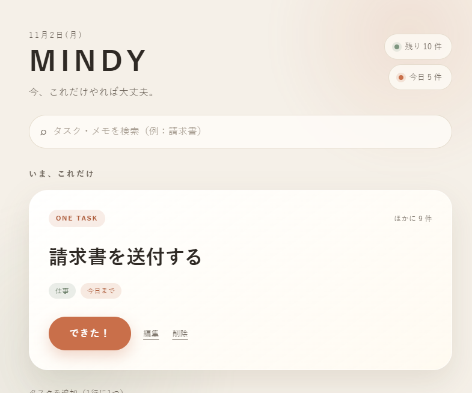
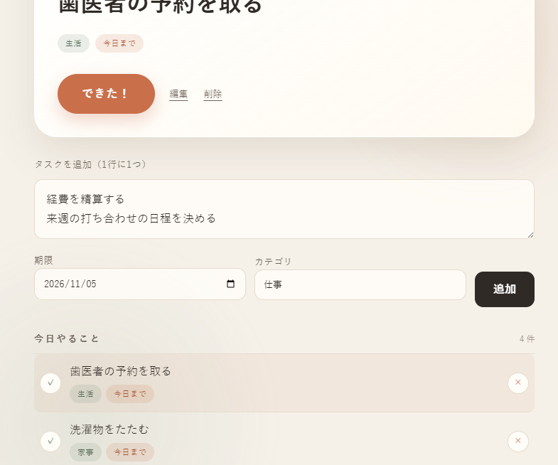
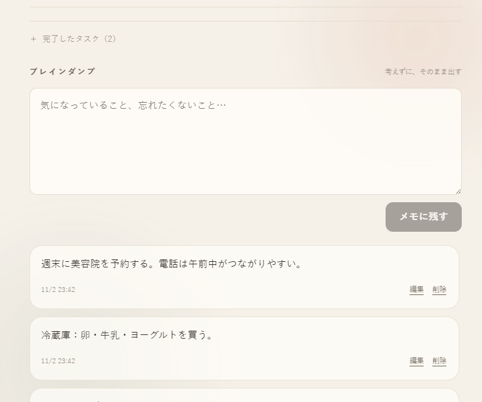
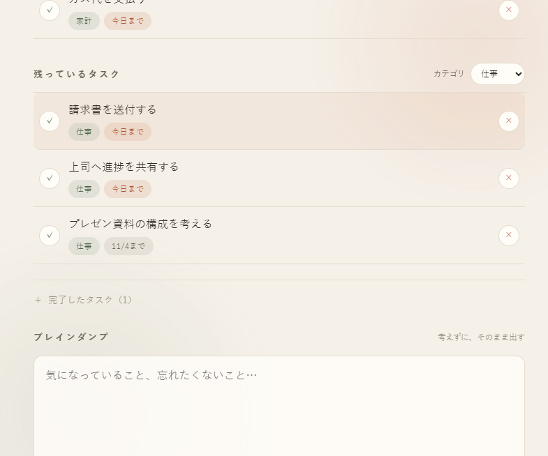
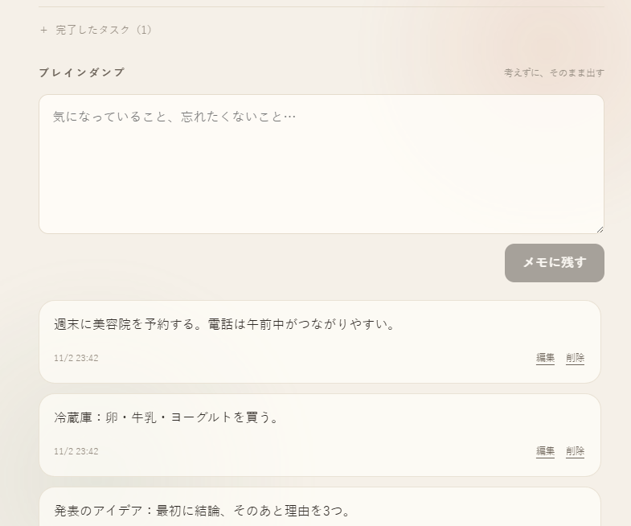
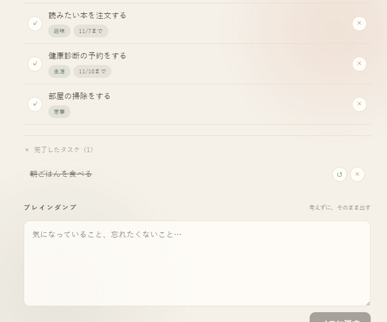
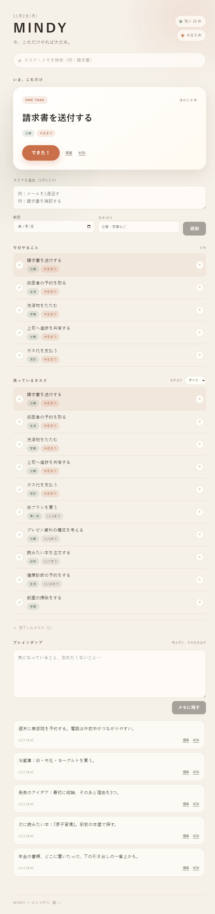
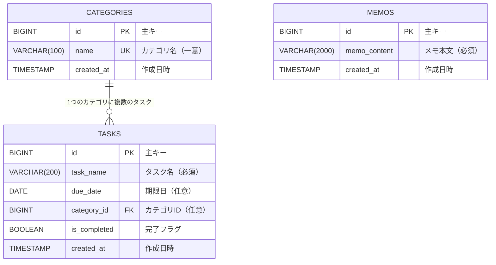
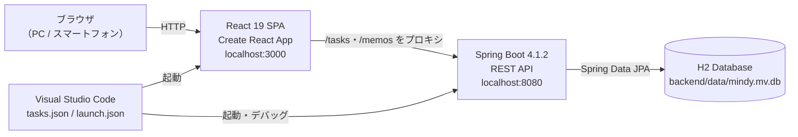

# MINDY

### 今、これだけやれば大丈夫。

MINDY は、ADHD・注意散漫になりがちな方や「やることが多すぎて何から手を付ければいいか分からない」と感じる方のための、**ワンタスク集中型タスク＆メモ管理アプリ**です。画面に「今取り組む1つ」だけを大きく表示し、頭の中の雑念はブレインダンプに逃がすことで、認知負荷を最小限に抑えます。

- GitHub リポジトリ: **https://github.com/contactoffice1f0-cyber/MINDY**
- 本番環境 URL: なし（ローカル環境で起動する構成です）

---

## アプリケーションの概要

### 誰の、どんな課題を解決するのか

> **「タスクが多すぎて選べない」「締切を忘れる」「頭の中がずっとタスクで埋まっている」** という課題を、*見せる情報を絞る* ことで解決します。

一般的なタスク管理アプリは、たくさんの項目・通知・階層構造を持っています。しかし、注意散漫になりがちな人にとっては、それ自体が「選ぶ負荷」になります。MINDY はあえて機能を絞り、

1. **今やる1件**をフォーカスカードに表示する
2. **今日が期限のタスク**だけを一覧にする
3. それ以外のタスクは「残っているタスク」にまとめる
4. 思いついたことは**分類せずにメモ**へ流す

という構造で、「まず1つ手を動かす」状態をつくります。

### 主な対象ユーザー

- ADHD 傾向があり、複数のタスクを同時に考えるのが苦手な方
- やることをメモしても、見返さずに忘れてしまう方
- 仕事・家事・買い物など、種類の異なるタスクを1つの画面で管理したい方
- スマートフォンからも、落ち着いた画面で操作したい方

---

## 開発した背景や理由

### 開発のきっかけ

私は普段、複数の予定や締切を抱えながら作業をしています。手帳やメモアプリにタスクを書き留めても、

- 書いたこと自体を忘れてしまう
- タスク一覧を開いた瞬間に「多すぎる」と感じて、何もできなくなる
- 期限が近いものと遠いものが同じ場所に並び、優先順位が分からなくなる

という状態が繰り返し起きていました。

既存のアプリを試しても、機能が多すぎて設定に時間がかかったり、通知が増えて逆に疲れたりしました。そこで、

> **「今日、これだけやれば大丈夫」と思える画面**

を自分でつくろうと考えたのが開発の出発点です。

### 解決したい課題と、開発方針

| 課題 | MINDY での解決 |
| :--- | :--- |
| タスクが多すぎて選べない | 「いま、これだけ」カードで常に1件だけを大きく表示 |
| 締切を忘れる | 期限日を登録し、「今日やること」を自動抽出 |
| 未完のタスクが埋もれる | 「残っているタスク」に件数付きで常時表示 |
| 頭の中がタスクで埋まる | 分類不要の「ブレインダンプ」に一旦書き出す |
| 達成感が得られない | 完了時に「おつかれさま！」のフィードバック |
| 探すのに時間がかかる | タスク名・カテゴリ・メモを横断検索 |

「機能を増やす」のではなく、**必要な情報だけを、落ち着いた見た目で出す**ことを重視しました。

---

## 主な機能

### タスク管理

- タスクの追加（1行に1つ、複数行の一括追加に対応）
- タスク名・期限・カテゴリの編集
- 完了 / 未完了への切り替え
- タスクの削除（確認ダイアログ付き）
- 期限日の登録（`YYYY-MM-DD`）
- カテゴリの登録・絞り込み（仕事、家事、生活など）
- 「今日やること」の自動抽出（期限が今日以前の未完了タスク）
- 未完了タスクの残数表示

### ワンタスク・フォーカス

- 未完了タスクのうち1件を「いま、これだけ」として大きく表示
- 一覧からタスクを選ぶと、フォーカス対象を切り替え
- 完了時に次のタスクへ自動でフォーカス

### ブレインダンプ（メモ）

- 思いついたことを分類せずに書き出せる
- メモの追加・編集・削除
- 新しいメモから順に表示

### 検索・その他

- タスク名・カテゴリ・メモ内容を横断検索（追加機能）
- カテゴリによる絞り込み（追加機能）
- 完了タスクは折りたたみ表示（画面を圧迫しない）
- レスポンシブ対応（スマートフォン幅でも1カラムに変化）
- 日本語 UI・落ち着いた配色

---

## アプリケーションのデモ（スクリーンショット）

本番環境は未デプロイのため、ローカル環境（`http://localhost:3000`）で撮影した**全画面のスクリーンショット**を掲載します。撮影時はサンプルデータを登録しています。

### 1. メイン画面（ワンタスク・フォーカス）

「いま、これだけ」に1件だけ表示し、その下にタスク追加フォームと「今日やること」が並びます。



### 2. タスク追加（複数行・期限・カテゴリ）

1行に1つずつ入力すると、まとめてタスクを追加できます。期限とカテゴリも同時に指定できます。



### 3. タスク編集

フォーカスカードの「編集」から、タスク名・期限・カテゴリを変更できます。



### 4. 検索（追加機能）

タスク名・カテゴリ・メモ内容を横断して検索します。ここでは「予約」で絞り込んでいます。


### 5. カテゴリ絞り込み（追加機能）

「残っているタスク」をカテゴリ単位で絞り込めます。ここでは「仕事」を選択しています。



### 6. ブレインダンプ（メモ）

考えを整理する前の状態で、そのまま書き出せます。メモは追加・編集・削除できます。



### 7. 完了したタスク

完了したタスクは折りたたみの中にまとまり、必要なときだけ確認できます。



### 8. 画面全体

<details>
<summary>画面全体のスクリーンショットを開く（縦に長い画像です）</summary>



</details>

---

## アプリケーションの URL

本番環境へのデプロイは行っていないため、**アプリケーション URL はありません**。  
上記のとおり、ローカル環境で起動して動作を確認できます。

---

## 主な使用技術（技術スタック）

| カテゴリ | 技術 |
| :--- | :--- |
| フロントエンド | JavaScript / TypeScript, React 19, Create React App (react-scripts 5) |
| バックエンド | Java 17, Spring Boot 4.1.2, Spring Web MVC, Spring Data JPA |
| データベース | H2 Database（ファイルモード / `backend/data/mindy`） |
| ビルド | Gradle 9.8.2（Wrapper）, npm |
| 開発環境 | Visual Studio Code（`tasks.json` / `launch.json` を同梱） |
| テスト | JUnit 5, Spring Boot Test, Jest / React Testing Library |
| バージョン管理 | Git / GitHub |

- フロントエンドは **React（TypeScript）** で構築し、`fetch` で Spring Boot の REST API を呼び出しています。
- バックエンドは **Spring Boot（Java）** で API を提供し、**Spring Data JPA** 経由で H2 データベースと連携しています。
- データはファイル型 H2 に保存されるため、**アプリを再起動しても保持**されます。

---

## ER 図（データベース設計）



### テーブルとリレーションの補足

- **CATEGORIES 1 : 多 TASKS**  
  1つのカテゴリに複数のタスクが紐づきます。タスク側は `category_id` を外部キーとして持ち、カテゴリ未設定（`NULL`）も許可しています。
- **MEMOS** はタスクやカテゴリに依存しない独立したテーブルです。思いついた内容を分類せずに保存するため、あえてリレーションを持たせていません。
- カテゴリ名には一意制約（`uk_categories_name`）を設定し、同じ名前のカテゴリが重複しないようにしています。
- API ではカテゴリを文字列（`"category": "仕事"`）として扱い、内部で `categories` テーブルに解決・保存します。

---

## インフラ構成図

本番環境は未構築のため、ローカル開発環境の構成を示します。



- フロントエンドの `package.json` に `"proxy": "http://localhost:8080"` を設定しているため、開発中は同一オリジン（`/tasks`、`/memos`）として API を呼び出せます。
- バックエンドは CORS も許可しており、`http://localhost:3000` から直接アクセスできます。
- データベースは外部サービスを使わず、H2 のファイルを `backend/data/` に保存します。

---

## ディレクトリ構成

```text
MINDY/
├── backend/
│   ├── src/main/java/com/example/mindy/
│   │   ├── MindyApplication.java
│   │   ├── Task.java / TaskRepository.java / TaskController.java
│   │   ├── Category.java / CategoryRepository.java
│   │   ├── Memo.java / MemoRepository.java / MemoController.java
│   │   ├── WebConfig.java
│   │   ├── ApiExceptionHandler.java
│   │   ├── dto/
│   │   │   ├── TaskRequest.java / TaskResponse.java
│   │   │   └── MemoRequest.java / MemoResponse.java
│   │   └── service/
│   │       ├── TaskService.java
│   │       └── MemoService.java
│   ├── src/test/java/com/example/mindy/ApiIntegrationTests.java
│   ├── src/main/resources/application.properties
│   └── build.gradle
├── frontend/
│   ├── src/
│   │   ├── App.tsx
│   │   ├── App.css
│   │   ├── api.ts
│   │   └── App.test.tsx
│   └── package.json
├── docs/screenshots/        # README 用のスクリーンショット
├── .vscode/                 # VS Code の実行・デバッグ設定
└── README.md
```

---

## API 仕様

ベース URL: `http://localhost:8080`（`/api` プレフィックスなし）

| メソッド | パス | 内容 | 主なステータス |
| :--- | :--- | :--- | :--- |
| GET | `/tasks` | タスク一覧を取得 | 200 |
| POST | `/tasks` | タスクを追加 | 201 / 400 |
| PUT | `/tasks/{id}` | タスクを更新 | 200 / 400 / 404 |
| DELETE | `/tasks/{id}` | タスクを削除 | 200 / 404 |
| GET | `/memos` | メモ一覧を取得 | 200 |
| POST | `/memos` | メモを追加 | 201 / 400 |
| PUT | `/memos/{id}` | メモを更新（編集機能のため追加） | 200 / 400 / 404 |
| DELETE | `/memos/{id}` | メモを削除 | 200 / 404 |

- バリデーションエラーは **400**、存在しない ID は **404**、想定外のエラーは **500** を返します。
- JSON は API 仕様に合わせて **snake_case** です（`task_name`、`due_date`、`is_completed`、`created_at`、`memo_content`）。

### リクエスト例

```jsonc
// POST /tasks
{
  "task_name": "請求書を送付する",
  "due_date": "2026-11-02",
  "category": "仕事"
}

// PUT /tasks/1（完了にする）
{
  "task_name": "請求書を送付する",
  "due_date": "2026-11-02",
  "category": "仕事",
  "is_completed": true
}

// POST /memos
{ "memo_content": "週末に美容院を予約する" }
```

### レスポンス例

```jsonc
// 201 Created（POST /tasks）
{
  "id": 1,
  "task_name": "請求書を送付する",
  "due_date": "2026-11-02",
  "category": "仕事",
  "is_completed": false,
  "created_at": "2026-11-02T23:42:46.458159"
}
```

### H2 コンソール

バックエンド起動中に `http://localhost:8080/h2-console` へアクセスします。

| 項目 | 値 |
| :--- | :--- |
| JDBC URL | `jdbc:h2:file:./data/mindy;DB_CLOSE_DELAY=-1` |
| ユーザー名 | `sa` |
| パスワード | 空 |

---

## ローカル環境での起動方法

### 必要環境

| ツール | バージョン |
| :--- | :--- |
| Java | 17 以上 |
| Node.js | 20 以上（動作確認: v26.13.0） |
| npm | Node.js に同梱のもの |
| Gradle | 同梱の Gradle Wrapper を使用（インストール不要） |

### 1. リポジトリを取得する

```powershell
git clone https://github.com/contactoffice1f0-cyber/MINDY.git
cd MINDY
```

### 2. バックエンド（Spring Boot）を起動する

```powershell
cd backend
.\gradlew.bat bootRun
```

`http://localhost:8080` で起動します。初回は Gradle の依存関係ダウンロードに数分かかります。

### 3. フロントエンド（React）を起動する

**別のターミナル**を開いて:

```powershell
cd frontend
npm install
npm start
```

`http://localhost:3000` をブラウザで開きます。

> `npm start` 実行時にブラウザが自動で開かない場合は、`http://localhost:3000` に直接アクセスしてください。

### 4. 動作確認

1. タスクを追加し、「今日やること」に表示されることを確認
2. タスクを完了し、「完了したタスク」に移動することを確認
3. メモを追加・編集・削除できることを確認
4. 検索欄にキーワードを入力し、タスクとメモが絞り込まれることを確認
5. バックエンドを停止・再起動し、データが残っていることを確認

### データのリセット

バックエンドを停止したうえで、`backend/data/` フォルダを削除すると初期状態に戻ります。

### Visual Studio Code から起動する

1. `MINDY` フォルダを VS Code で開く
2. `Ctrl + Shift + B` → **MINDY: run all** を選択（バックエンドとフロントエンドを並列起動）
3. デバッグ実行は「実行とデバッグ」→ **MINDY (Backend + Frontend)** を選択

---

## テスト

```powershell
# バックエンド（API の CRUD・バリデーション・404 を検証）
cd backend
.\gradlew.bat test

# フロントエンド
cd frontend
npm test -- --watchAll=false
```

- バックエンド: `ApiIntegrationTests` でタスク／メモの登録・表示・更新・削除、400／404 のレスポンスを検証
- フロントエンド: `App.test.tsx` で初期画面の描画を検証

---

## 工夫した点・苦労した点と、解決方法

### 1. 「タスクが多すぎて選べない」への工夫

**工夫**: 未完了タスクの中から常に1件だけを「いま、これだけ」として大きく表示する構成にしました。加えて、「今日やること」と「残っているタスク」を分け、完了済みは折りたたみました。

**苦労した点**: 情報を減らしすぎると、今度は「全体が見えない」不安が出ます。そこで、ヘッダーに未完了件数と今日の件数を表示し、必要なときだけ一覧を確認できるバランスに調整しました。

### 2. データが再起動で消える問題

**苦労した点**: 開発初期は H2 のインメモリモードで動かしていたため、バックエンドを再起動するたびにタスクが消えていました。

**解決**: `spring.datasource.url` を `jdbc:h2:file:./data/mindy;DB_CLOSE_DELAY=-1` に変更し、`spring.jpa.hibernate.ddl-auto=update` を設定しました。これにより、再起動後もデータが保持されます。テスト用には別途インメモリの設定を用意し、本番用データを汚さないようにしています。

### 3. カテゴリの持ち方と ER 設計

**苦労した点**: 最初はタスクの `category` を単なる文字列として保存していました。しかし、それでは「カテゴリ」というデータの実体がなく、テーブル間のリレーションを説明できませんでした。

**解決**: `Category` エンティティを追加し、`Task` から `@ManyToOne` で参照する **1対多** の関係に変更しました。API の仕様は変えずに済むよう、DTO（`TaskResponse`）でカテゴリ名を文字列に変換しています。既存の API 利用者への影響を抑えつつ、データベース設計としては正規化できました。

### 4. snake_case の API と camelCase の React

**苦労した点**: API 仕様は `task_name` や `is_completed` の snake_case ですが、React 側では camelCase で扱いたいという違いがありました。

**解決**: `frontend/src/api.ts` に DTO とアプリ内モデルの変換層を設けました。コンポーネントは camelCase のまま扱え、API との境界だけを意識すればよい構造になっています。

### 5. 日本語データの動作確認で文字化け

**苦労した点**: PowerShell から日本語の JSON を送ると文字化けし、登録内容が壊れることがありました。

**解決**: JSON を UTF-8（BOM なし）のファイルに書き出し、`curl.exe --data-binary @file` で送信する方法に統一しました。あわせて、テストデータも UTF-8 で管理しています。

### 6. React 19 / TypeScript の型エラー

**苦労した点**: ライブラリの型定義と React 19 の組み合わせで、イベントハンドラや状態更新の型エラーが発生しました。

**解決**: `Task` / `Memo` / `TaskInput` の型を `api.ts` に集約し、コンポーネント側では推論に任せすぎず明示的に型を付けるようにしました。`tsc --noEmit` と ESLint を都度実行し、警告も解消しています。

### 7. バックエンドとフロントエンドの接続

**苦労した点**: ポートが異なるため、当初は CORS エラーが発生しました。

**解決**: Spring 側に `WebConfig` で CORS 設定を追加し、フロントエンド側は `package.json` の `proxy` を利用する構成にしました。開発時は `/tasks`、`/memos` という同一オリジンのパスで呼び出せます。

---

## 今後の展望

- 期限が近いタスクのリマインド通知
- 繰り返しタスク（毎日・毎週）の登録
- タスクの並び替え（ドラッグ＆ドロップ）
- オフラインでも使える PWA 対応
- ユーザー認証と複数ユーザー対応
- テストカバレッジの拡充

---

## GitHub リポジトリ

**https://github.com/contactoffice1f0-cyber/MINDY**

フロントエンドとバックエンドを1つのリポジトリで管理しています。開発の経過が分かるよう、機能単位でコミットを重ねています。
